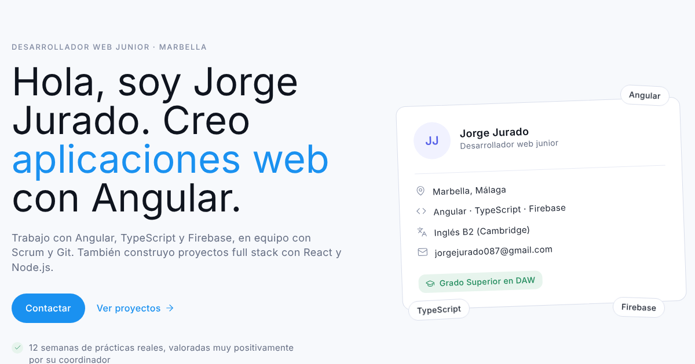

# CV de Jorge Jurado

Mi CV en formato web ([cv-jorgejuradog.netlify.app](https://cv-jorgejuradog.netlify.app)): quién soy, con qué tecnologías trabajo, mi experiencia, mis proyectos y un formulario de contacto.



## Tecnologías

- **Angular 20**: componentes standalone, signals y `OnPush`.
- **Tailwind CSS 4**, con los colores y la tipografía del diseño definidos como tokens en `src/styles.css`.
- **Prerenderizado estático** (`outputMode: static`): la página se genera como HTML en el build, lo que la hace rápida y fácil de indexar.
- **Web3Forms** para enviar el formulario de contacto sin backend propio.
- Publicado en **Netlify**.

## Cómo editar el contenido

Todo el texto del CV está en un único archivo: [`MiCv/src/app/data/portfolio.data.ts`](MiCv/src/app/data/portfolio.data.ts). Los campos marcados como `PENDIENTE` (foto y CV en PDF) se muestran solos en cuanto tienen valor.

## Desarrollo

```bash
cd MiCv
npm install
npm start          # servidor local en http://localhost:4200
npm run build      # genera la web estática en dist/micv/browser
npm test           # tests con Karma y Jasmine
```

## Estructura

```
MiCv/src/app/
  data/portfolio.data.ts   contenido del CV
  navbar, hero, about, tecnologias, experiencia, proyectos, formacion, contacto
  shared/icon.ts           iconos SVG en línea (sin dependencias)
  shared/reveal.ts         animación suave al aparecer en pantalla
```
